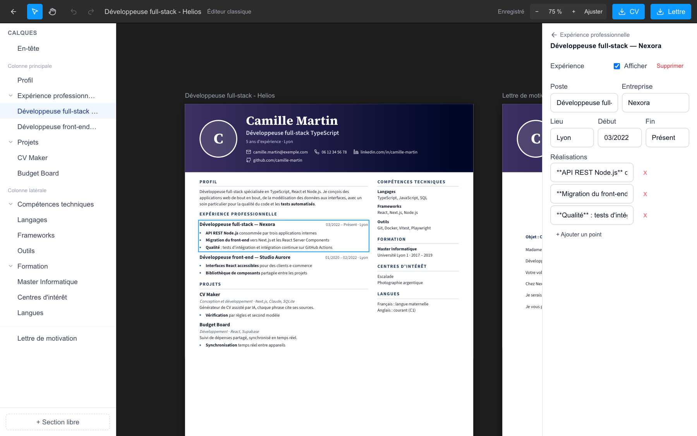
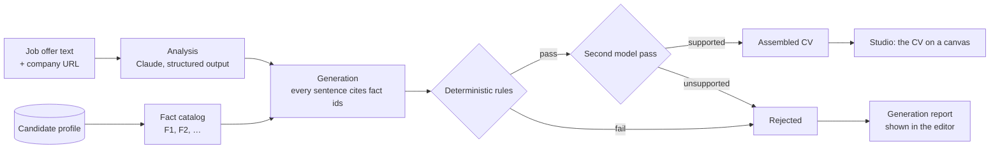

# CV Maker

[](https://github.com/davy-dev/cv-maker/actions/workflows/quality.yml)

An AI resume builder that tailors a CV and cover letter to a job offer **without inventing anything**.
Every sentence Claude writes must cite facts from the candidate's profile, and is checked by deterministic
rules and a second model pass before it reaches the CV. Sentences that fail are left out and shown to the
user, along with the skills the offer asks for that the candidate does not have yet.

Built with Next.js 16 (App Router, React 19), the Anthropic SDK with structured outputs, Drizzle + SQLite,
HTML templates printed to PDF by Chrome.



## How it works



1. **Job analysis** ([`app/api/ai/analyze`](app/api/ai/analyze/route.ts)): Claude reads the offer, the
   company page (scraped with SSRF protection, [`lib/scraper/safe-url.ts`](lib/scraper/safe-url.ts)) and
   the candidate's skills, and returns a match score, matched and missing skills.
2. **Fact catalog** ([`lib/ai/facts.ts`](lib/ai/facts.ts)): the profile is flattened into numbered facts
   (`[F12] Réalisation : …`), each tied to the experience, project or skill it describes. This is the only
   material the model may use.
3. **Grounded generation** ([`lib/ai/grounded-cv.ts`](lib/ai/grounded-cv.ts),
   [`lib/ai/schemas.ts`](lib/ai/schemas.ts)): the output schema is built per request. Fact ids, experience
   ids, project ids and skill names are closed enums, so the API cannot return a source that does not exist
   or a skill the candidate does not have. Every sentence is `{ text, sourceIds }`.
4. **Rule checks** ([`lib/ai/verify.ts`](lib/ai/verify.ts)), free and deterministic:
   - at least one valid source;
   - every number in the sentence appears in its sources;
   - a bullet about an experience or project cites facts of *that* experience or project, never another one.
5. **Second model pass**: Claude compares each remaining sentence with the facts it cites and returns a
   verdict per claim. A claim without a verdict is not trusted. If this pass fails, the CV is still built
   from the rule-checked claims and the report says verification was `rules-only`.
6. **Assembly** ([`lib/ai/cv.ts`](lib/ai/cv.ts)): companies, positions, dates, degrees, project names and
   links always come from the database, never from the model. When every rewritten bullet of an experience
   is rejected, the candidate's own words are used instead.
7. **Report** ([`components/cv/generation-report.tsx`](components/cv/generation-report.tsx)): the editor
   lists rejected sentences with the reason, and the skills to acquire, which never appear on the CV.

## Features

- Job offer analysis with match score and skill gaps
- Grounded CV generation with source citations and verification (above)
- Cover letter generation from the same analysis
- Studio, a Figma-like editor: the CV and its letter on a canvas, text edited in place, sections and
  entries reordered by dragging, layers, inspector, undo
- One HTML template in 5 styles (Executive, Modern, Classic, Minimalist, Elegant), printed to PDF by
  Chrome from the same HTML, so what is shown is what is downloaded
- Profile, experiences, projects and skills management, photo upload
- Credentials, GitHub and Google sign-in (NextAuth v5)

## Tech stack

| Area       | Choice                                                     |
| ---------- | ---------------------------------------------------------- |
| Framework  | Next.js 16 (App Router, typed routes), React 19            |
| AI         | Anthropic SDK, structured outputs validated with Zod       |
| Data       | SQLite (better-sqlite3) + Drizzle ORM, SQL migrations      |
| Auth       | NextAuth v5                                                |
| PDF        | HTML templates printed by Chrome (playwright-core)         |
| UI         | Tailwind CSS v4, React Hook Form                           |
| Tests      | Vitest, Testing Library, Playwright                        |

## Getting started

Requirements: Node 22 (see [`.nvmrc`](.nvmrc)) and an Anthropic API key.

```bash
npm ci
cp .env.example .env.local     # fill in AUTH_SECRET and ANTHROPIC_API_KEY
mkdir -p data
npm run db:migrate             # creates data/cv-maker.db
npm run dev                    # http://localhost:3000
```

GitHub and Google sign-in are optional; email + password works without them.

PDFs are printed by the installed Google Chrome. Without it, run `npx playwright install chromium` and set
`PDF_BROWSER_CHANNEL=""` in `.env.local`.

Then: create an account, fill in your profile and skills, open **Nouveau CV**, paste a job offer and
generate.

## Testing

| Command                 | What it runs                                                                 |
| ----------------------- | ---------------------------------------------------------------------------- |
| `npm run test`          | Vitest in watch mode: unit, integration and component tests                  |
| `npm run test:run`      | Same, single run                                                             |
| `npm run test:coverage` | Single run with coverage in `coverage/`, fails below the thresholds in `vitest.config.mts` |
| `npm run test:e2e`      | Playwright against a production build on port 3100, with its own database (`data/e2e.db`) |
| `npm run lint` / `npm run typecheck` | Static checks                                                   |

- Integration tests run against an in-memory SQLite database migrated from `lib/db/migrations`; auth and
  the Claude API are mocked.
- Tests marked `it.fails` document known bugs: when a bug is fixed the test starts failing, so switch it to
  `it`.
- All checks run in GitHub Actions on every push to `main` and every pull request
  ([`.github/workflows/quality.yml`](.github/workflows/quality.yml)).

## Project structure

```
app/                  routes: (auth), (dashboard), api/ai, api/scrape, api/upload
components/cv/        studio (canvas, layers, inspector), classic editor, HTML templates, generation report
lib/cv/               CV reducer, layout, fields, undo history, print to PDF
lib/ai/               facts, schemas, prompts, generation, verification, CV assembly
lib/db/               Drizzle schema and migrations
lib/scraper/          company page scraping with SSRF protection
tests/                unit, integration, components, e2e
```
